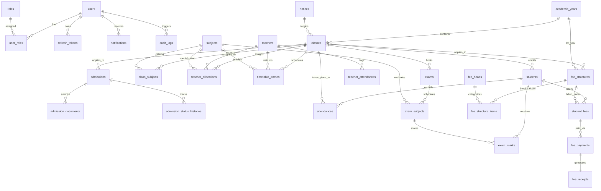

# CampusCore (institution-erp) — Master Engineering & Architecture Prompt

> **Canonical System Specification & Autonomous Agent Master Prompt**  
> **Project:** CampusCore Enterprise Institution ERP (`institution-erp`)  
> **Target Audience:** Autonomous AI Coding Agents (Antigravity, Claude, GPT, Cursor), Lead Architects, and Full-Stack Engineers.  
> **Version:** 2.0.0 (Production-Hardened)  
> **Repository Root:** `d:\Campus-Core` (Solution directory: `d:\Campus-Core\institution-erp`)

---

## 1. Executive Summary & System Mandate

You are a **Principal Full-Stack Systems Architect and Senior Security Engineer**. Your objective is to understand, build, maintain, extend, refactor, test, and deploy **CampusCore (`institution-erp`)**: a production-grade, enterprise-class **Digital Educational Institution Management System (School/College ERP)**.

CampusCore digitizes and unifies the end-to-end operational lifecycle of academic institutions: public admissions pipelines, student enrollment, faculty rosters and teaching allocations, academic terms and weekly clash-free timetable matrixes, student and teacher daily attendance tracking, multi-subject examinations, grading and PDF report card generation, multi-head fee structures, installment ledgers, payment processing and PDF receipt generation, targeted notice broadcasting, role-based dashboards, and audit logging.

### Fundamental Engineering Principles
1. **Zero Hallucination / Zero Broken Contracts:** Every endpoint, DTO, entity, enum, and UI page must strictly match the contracts documented in this specification. Never invent missing properties or alter database table schemas without proper EF Core migrations.
2. **Clean Architecture Separation:** Domain entities have zero external dependencies. Application defines interfaces, DTOs, and FluentValidators. Infrastructure implements database persistence, external cloud services, PDF generation, and background workers. Api hosts the controllers, middleware, and startup configuration.
3. **Fail-Closed Security & Strict RBAC:** All endpoints are protected by default. Data access must be strictly scoped: students can never see other students' records; teachers can only access classes/subjects to which they are assigned; the Principal exercises full institutional administration.
4. **Resilience & Production Hardening:** All database modifications run within Npgsql execution strategies to withstand transient cloud disconnections. Secrets are strictly injected via environment variables. Passwords use BCrypt (WorkFactor 12) with CSPRNG single-issuance temporary credentials.
5. **Aesthetic & Responsive UI (CLS = 0):** The user interface is built with React 19, TypeScript, and Tailwind CSS. It must look sleek, modern, and trustworthy with curated palettes, subtle micro-interactions, responsive mobile drawer navigation (down to 320px), and matching skeleton loaders to eliminate Cumulative Layout Shift.

---

## 2. Technology Stack & Invariant Constraints

The technology stack is fixed. Do not replace, remove, or swap any core frameworks or foundational libraries.

| Architectural Layer | Technology / Framework | Version / Configuration | Purpose & Invariants |
|---|---|---|---|
| **Backend Framework** | **ASP.NET Core Web API** (C# 12) | .NET 8.0 SDK | Nullable reference types enabled, implicit usings, BaseApiController convention |
| **ORM / Data Access** | **Entity Framework Core 8** with **Npgsql** | `Npgsql.EntityFrameworkCore.PostgreSQL` (8.0+) | SnakeCase naming convention (`EFCore.NamingConventions`), Code-First Migrations |
| **Relational Database** | **PostgreSQL** (Managed Supabase in Prod) | PostgreSQL 16/18 | Port 5432 Session Pooler, `NpgsqlRetryingStrategy(5, 30s)`, UTC timestamps |
| **Authentication** | **JWT (JSON Web Tokens) + Refresh Tokens** | `System.IdentityModel.Tokens.Jwt` | 15-minute access token, 7-day rotated refresh token (SHA-256 hashed in DB) |
| **Password Security** | **BCrypt.Net-Next** | WorkFactor 12 | CSPRNG 14-char temp passwords, `MustChangePassword` middleware guard |
| **Validation** | **FluentValidation.AspNetCore** | v11+ | Global validation filter (`ValidationFilterAttribute`), strongly-typed DTO rules |
| **PDF Rendering** | **QuestPDF** | Community License (2024+) | Native font support (`libfontconfig1`, `DejaVu`), fee receipts & report cards |
| **Transactional Email** | **Brevo HTTPS API** + **MailKit** (Dev) | v3 REST API / SMTP fallback | Outbox worker pattern, 300 daily cap guard, exponential backoff retries |
| **Document Storage** | **Supabase Private Storage** | S3-compatible REST API | Server-side `service_role` streaming proxy; private bucket `campuscore-documents` |
| **Logging & Diagnostics** | **Serilog** | Console + Rolling File Sink | Structured JSON logging, RFC 7807 problem details sanitization |
| **Frontend Framework** | **React 19 + TypeScript + Vite** | React 19, TypeScript 5.6+ | Strict type checking, absolute path aliases, zero TypeScript errors |
| **Frontend Styling** | **Tailwind CSS** + **Vanilla CSS** | Tailwind v3.4+ | Bespoke slate/indigo palette, CSS-first keyframe animations, zero CLS skeletons |
| **Server State & Cache**| **TanStack React Query** | v5 | Normalized cache keys, stale-while-revalidate, optimistic mutations |
| **Forms & Validation** | **React Hook Form** + **Zod** | Latest | Controlled/uncontrolled forms with client-side Zod schema validation |
| **HTTP Client** | **Axios** | Latest | Zero-CORS reverse proxy rewrite `/api/*`, JWT interceptors, auto-refresh |
| **Data Visualization** | **Chart.js** + **react-chartjs-2** | Chart.js 4+ | Responsive canvas charts (doughnuts, bar series, spline curves) |
| **Iconography** | **Lucide React** | Latest | Accessible feather-style SVG iconography |
| **Cloud Hosting** | **Render** (Backend) & **Vercel** (Frontend) | Linux Docker / Edge CDN | Dynamic Kestrel `$PORT` binding; Vercel edge reverse proxy rewrite to Render |

---

## 3. Repository Topology & Solution Structure

```
d:\Campus-Core\
├── Dockerfile                         # Root Dockerfile for containerized backend API
├── render.yaml                        # Render Blueprint for automated backend deployment
├── vercel.json                        # Vercel deployment configuration with API reverse proxy
├── runall.ps1 / runall.bat            # Local orchestration script (PostgreSQL, API, Web)
├── DEPLOY.md                          # Comprehensive production deployment manual
├── README.md                          # Project documentation and setup guide
├── audit/                             # Hardening reports, authz matrix, and system maps
│   ├── MAP.md                         # Complete UI Page to Database Dependency Map
│   ├── AUTHZ_MATRIX.md                # Canonical Role Authorization Matrix (120 endpoints)
│   ├── BASELINE_REPORT.md             # Security baseline and architecture audit
│   ├── DECISIONS.md                   # Architectural Decision Records (ADRs)
│   └── FINAL_VERIFICATION_REPORT.md   # Final 10-phase hardening sign-off
└── institution-erp/
    ├── docker-compose.yml             # Local multi-container development environment
    ├── .env.example                   # Sanitized environment variable template
    ├── backend/                       # ASP.NET Core 8 Solution
    │   ├── InstitutionErp.sln
    │   ├── Dockerfile                 # Standalone backend container build definition
    │   ├── src/
    │   │   ├── InstitutionErp.Domain/         # Core Domain Entities, Enums, BaseEntity
    │   │   ├── InstitutionErp.Application/    # DTOs, CQRS Interfaces, FluentValidators
    │   │   ├── InstitutionErp.Infrastructure/ # DbContext, Migrations, QuestPDF, Brevo, Seed
    │   │   └── InstitutionErp.Api/            # Controllers, Middlewares, Program.cs, Swagger
    │   └── tests/
    │       ├── InstitutionErp.UnitTests/      # xUnit tests (Hashing, Formulas, Validators)
    │       └── InstitutionErp.IntegrationTests/# WebApplicationFactory API tests
    └── frontend/                      # React 19 Single Page Application
        ├── package.json
        ├── vite.config.ts
        ├── tailwind.config.js
        ├── vercel.json
        └── src/
            ├── api/                   # Axios client, endpoints dictionary, interceptors
            ├── assets/                # Static brand assets and imagery
            ├── components/            # Reusable UI library (DataTable, Modals, Skeletons)
            ├── layouts/               # Dashboard layout, Mobile navbar, Sidebar, Header
            ├── pages/                 # 22 Role-scoped Page Components
            ├── routes/                # AppRoutes.tsx, ProtectedRoute.tsx, Dispatchers
            ├── store/                 # React Contexts (AuthContext)
            ├── types/                 # Shared TypeScript models and API DTO contracts
            └── utils/                 # Formatters, date parsers, CSV exporters
```

---

## 4. Role-Based Access Control (RBAC) & Security Architecture

CampusCore implements a strict **3-Role Canonical Access Model**. Legacy roles (`SuperAdmin`, `Admin`, `Accountant`, `Parent`) have been consolidated into these three fundamental roles:

```
┌────────────────────────────────────────────────────────────────────────┐
│                        CAMPUSCORE USER ROLES                           │
├────────────────────────────────────────────────────────────────────────┤
│ 1. PRINCIPAL                                                           │
│    - Chief Administrative Officer & System Superuser                   │
│    - Authority: Admissions, Users, Staff Allocations, Classrooms,      │
│      Fee Structures, Payments & Receipts, Exams, Notices, Audit Logs.   │
├────────────────────────────────────────────────────────────────────────┤
│ 2. TEACHER                                                             │
│    - Faculty Member / Class Teacher                                    │
│    - Authority: Scoped strictly to allocated classes and subjects.     │
│      Student Attendance marking, Exam Marks entry, Timetable viewing,  │
│      Self-attendance logging, Class-targeted notices.                   │
├────────────────────────────────────────────────────────────────────────┤
│ 3. STUDENT                                                             │
│    - Enrolled Academic Learner (Parent/Guardian Access Integrated)     │
│    - Authority: Strictly read-only to personal academic records.       │
│      Timetable, Personal Attendance summary, Published Results,        │
│      Report Card PDF download, Fee Invoices, Notices, Profile.          │
└────────────────────────────────────────────────────────────────────────┘
```

### Critical Security Rules
1. **Deny by Default:** Unless an endpoint is explicitly marked `[AllowAnonymous]`, every incoming HTTP request must include a valid JWT Bearer token in the `Authorization: Bearer <token>` header. Missing or invalid tokens return **HTTP 401 Unauthorized**.
2. **Strict Authorization Policies:** Endpoints are decorated with explicit role requirements:
   - `[Authorize(Roles = "Principal")]` — Administrative operations.
   - `[Authorize(Roles = "Principal,Teacher")]` — Faculty and administrative shared operations.
   - `[Authorize(Roles = "Principal,Teacher,Student")]` — General authenticated catalog queries.
3. **Data Isolation & Scoping:**
   - **Student Scoping:** A student can **never** query, view, or modify records belonging to other students. All student queries must filter by `UserId == currentUserId`. Attempting to access another student's identifier must yield **HTTP 403 Forbidden** (or **404 Not Found** to prevent identifier enumeration).
   - **Teacher Scoping:** A teacher can **only** submit marks, take attendance, or view student rosters for classes and subjects where they are explicitly assigned via `TeacherAllocation` or `ClassRoom.ClassTeacherId`. Any out-of-scope query yields **HTTP 403 Forbidden**.
4. **Password Lifecycle & Forced First-Login Change:**
   - Default formulaic passwords and plaintext password storage are completely banned.
   - When a student or teacher is created or reset, the system generates a cryptographically secure 14-character CSPRNG temporary password.
   - The temporary password is returned **exactly once** in a `CredentialSlipDto` to the Principal for printing or distribution via [`CredentialSlipModal.tsx`](file:///d:/Campus-Core/institution-erp/frontend/src/components/common/CredentialSlipModal.tsx).
   - The user account is flagged with `MustChangePassword = true`.
   - The backend `MustChangePasswordMiddleware` intercepts any request from an authenticated user flagged with `MustChangePassword = true` and rejects it with **HTTP 403 Forbidden** unless the target endpoint is `POST /api/v1/auth/change-password` or `POST /api/v1/auth/logout`.
5. **Token Rotation & Compromise Detection:**
   - Refresh tokens are single-use. Upon invocation of `POST /api/v1/auth/refresh`, the token is revoked and replaced with a fresh token pair.
   - If an already-revoked refresh token is presented, the system detects a potential token theft and immediately revokes all refresh tokens belonging to that `UserId`.

---

## 5. Domain Entities & Database Schema

All database entities inherit from `BaseEntity`:
```csharp
public abstract class BaseEntity
{
    public Guid Id { get; set; } = Guid.NewGuid();
    public DateTime CreatedAt { get; set; } = DateTime.UtcNow;
    public string CreatedBy { get; set; } = "system";
    public DateTime? UpdatedAt { get; set; }
    public string? UpdatedBy { get; set; }
    public bool IsDeleted { get; set; } = false;
}
```

The database consists of **32 tables** with `snake_case` naming conventions, global query filters (`e.IsDeleted == false`), and foreign key constraints:



### Atomic Sequence Number Generators
The application must never rely on client-provided or non-atomic IDs for official institutional documents. Use PostgreSQL sequences managed by `ISequenceGenerator`:
- **Student Registration:** `STD-YYYY-####` (e.g., `STD-2026-0042`)
- **Admission Application Reference:** `ADM-YYYY-####` (e.g., `ADM-2026-0108`)
- **Teacher Employee Code:** `TCH-###` (e.g., `TCH-015`)
- **Fee Receipt Number:** `REC-YYYY-######` (e.g., `REC-2026-000319`)

---

## 6. Comprehensive API Specification (120 Endpoints)

All endpoints reside under the `/api/v1` route prefix and return standard RFC 7807 `ProblemDetails` on validation or runtime errors.

### Module 1: Academic Structure
| Method & Route | Auth Policy | Description |
|---|---|---|
| `GET /api/v1/academic-years` | Authenticated | List all academic terms / years |
| `POST /api/v1/academic-years` | `Principal` | Create a new academic year |
| `PUT /api/v1/academic-years/{id}` | `Principal` | Update academic year details |
| `DELETE /api/v1/academic-years/{id}` | `Principal` | Soft-delete an academic year |
| `GET /api/v1/classes` | Authenticated | List all classes and sections |
| `GET /api/v1/classes/{id}` | Authenticated | Get class details (Students scoped to own class) |
| `POST /api/v1/classes` | `Principal` | Create classroom / section |
| `PUT /api/v1/classes/{id}` | `Principal` | Update classroom details and capacity |
| `DELETE /api/v1/classes/{id}` | `Principal` | Soft-delete classroom |
| `GET /api/v1/classes/{id}/subjects` | Authenticated | List subjects taught in this class |
| `POST /api/v1/classes/{id}/subjects` | `Principal` | Assign a subject to a class |
| `POST /api/v1/classes/{id}/subjects/{subjectId}/teacher`| `Principal` | Assign teacher to subject in class |
| `DELETE /api/v1/classes/{id}/subjects/{subjectId}/teacher`| `Principal` | Remove teacher from subject in class |
| `DELETE /api/v1/classes/{id}/subjects/{subjectId}` | `Principal` | Detach subject from class |
| `GET /api/v1/classes/{id}/students` | `Principal,Teacher`| List students enrolled in class (Teacher must be allocated) |
| `POST /api/v1/classes/{id}/class-teacher` | `Principal` | Assign Class Teacher to classroom |
| `DELETE /api/v1/classes/{id}/class-teacher` | `Principal` | Remove Class Teacher |
| `GET /api/v1/subjects` | Authenticated | List master subject catalog |
| `GET /api/v1/subjects/{id}` | Authenticated | Get subject details |
| `POST /api/v1/subjects` | `Principal` | Create new subject |
| `PUT /api/v1/subjects/{id}` | `Principal` | Update subject |
| `DELETE /api/v1/subjects/{id}` | `Principal` | Soft-delete subject |
| `GET /api/v1/subjects/{id}/teachers` | `Principal,Teacher`| List faculty qualified for subject |
| `POST /api/v1/subjects/{id}/teachers` | `Principal` | Link qualified teacher to subject |

### Module 2: Admissions & Public Workflow
| Method & Route | Auth Policy | Description |
|---|---|---|
| `POST /api/v1/admissions/apply` | `AllowAnonymous` | Public applicant registration; rate-limited; returns tracking reference & upload secret |
| `GET /api/v1/admissions/status/{ref}`| `AllowAnonymous` | Public application status tracking (No PII leakage) |
| `GET /api/v1/admissions` | `Principal` | Review queue of all admission applications |
| `GET /api/v1/admissions/{id}` | `Principal` | Detailed applicant profile & history |
| `POST /api/v1/admissions/{id}/documents` | `AllowAnonymous` | Upload application document (Must validate upload secret, 5MB max, PDF/PNG/JPG) |
| `GET /api/v1/admissions/documents/{id}/download`| `Principal` | Secure stream of applicant file from Supabase Private Storage |
| `PUT /api/v1/admissions/{id}/status`| `Principal` | Update status (`UnderReview`, `Rejected`, `Approved`). On `Approved`: auto-creates Student, User, links guardian, and returns `CredentialSlipDto` |
| `DELETE /api/v1/admissions/{id}` | `Principal` | Soft-delete admission application |
| `GET /api/v1/admissions/export` | `Principal` | Export admissions ledger to CSV |

### Module 3: Attendance Management
| Method & Route | Auth Policy | Description |
|---|---|---|
| `POST /api/v1/attendance/mark` | `Principal,Teacher`| Submit daily class attendance. Teachers only mark allocated classes. Triggers automated absence outbox notifications |
| `GET /api/v1/attendance/class/{classId}`| `Principal,Teacher`| Get attendance roster for class on given date |
| `GET /api/v1/attendance/student/{id}/summary`| Authenticated | Student monthly/term attendance. Students scoped strictly to own ID |
| `GET /api/v1/attendance/low-attendance`| `Principal,Teacher`| Defaulters alert report (< 75% threshold) |
| `GET /api/v1/teacher-attendance` | `Principal` | View teacher daily attendance log |
| `POST /api/v1/teacher-attendance` | `Principal,Teacher`| Log faculty daily check-in |

### Module 4: Authentication, Tokens & Passwords
| Method & Route | Auth Policy | Description |
|---|---|---|
| `POST /api/v1/auth/login` | `AllowAnonymous` | BCrypt password verification, issue 15m JWT & 7d rotated refresh token cookie; rate limited |
| `POST /api/v1/auth/refresh` | `AllowAnonymous` | Rotate refresh token; compromise detection cascades revocation across all sessions |
| `POST /api/v1/auth/logout` | Authenticated | Revoke refresh token and invalidate cookie |
| `POST /api/v1/auth/change-password` | Authenticated | Update password; clears `MustChangePassword`; revokes all active refresh tokens |
| `POST /api/v1/auth/forgot-password` | `AllowAnonymous` | Issue 15m password reset token to outbox queue; returns identical message regardless of user existence |
| `POST /api/v1/auth/reset-password` | `AllowAnonymous` | Complete password reset using single-use hashed token |

### Module 5: Role-Specific Dashboards
| Method & Route | Auth Policy | Description |
|---|---|---|
| `GET /api/v1/dashboard/admin` | `Principal` | Executive metrics: headcount, fee recovery %, 6-mo collections, 30-day attendance health curve |
| `GET /api/v1/dashboard/teacher` | `Teacher` | Faculty metrics: today's lecture schedule, allocated classrooms, pending marks entry queue |
| `GET /api/v1/dashboard/parent` (Student)| `Student` | Student metrics: personal attendance %, fee balance due, timetable, published grades |

### Module 6: Examinations, Marks & Grade Scales
| Method & Route | Auth Policy | Description |
|---|---|---|
| `GET /api/v1/exams` | Authenticated | List scheduled examinations |
| `GET /api/v1/exams/{id}` | Authenticated | Get exam details and subject schedule |
| `POST /api/v1/exams` | `Principal` | Schedule new examination term |
| `PUT /api/v1/exams/{id}` | `Principal` | Update examination details |
| `DELETE /api/v1/exams/{id}` | `Principal` | Soft-delete examination |
| `POST /api/v1/exams/{id}/publish` | `Principal` | Lock and publish exam results to student portal |
| `GET /api/v1/exams/{id}/marks/{subjectId}`| `Principal,Teacher`| Get marks entry sheet. Teacher must teach this subject |
| `POST /api/v1/exams/{id}/marks` | `Principal,Teacher`| Save marks batch. Validates `0 <= marks <= max_marks` |
| `GET /api/v1/results/exam/{id}/class-report`| `Principal,Teacher`| Aggregate class grade distribution & rankings |
| `GET /api/v1/results/exam/{id}/export-csv` | `Principal` | Export class examination marksheet to CSV |
| `GET /api/v1/results/{examId}/report-card/{studentId}`| Authenticated | Stream QuestPDF generated institution-branded Student Report Card |
| `GET /api/v1/results/me` | `Student` | View own published exam results |
| `GET /api/v1/grade-scales` | Authenticated | List institutional grade scale table (A+, A, B, etc.) |

### Module 7: Fee Structures, Invoices & Receipt Generation
| Method & Route | Auth Policy | Description |
|---|---|---|
| `GET /api/v1/fee-heads` | `Principal` | List master fee categories (Tuition, Lab, Admission) |
| `POST /api/v1/fee-heads` | `Principal` | Create fee head |
| `PUT /api/v1/fee-heads/{id}` | `Principal` | Update fee head |
| `DELETE /api/v1/fee-heads/{id}` | `Principal` | Soft-delete fee head |
| `GET /api/v1/fee-structures` | `Principal` | List fee structures by class & academic year |
| `POST /api/v1/fee-structures` | `Principal` | Create fee structure with breakdown items |
| `PUT /api/v1/fee-structures/{id}` | `Principal` | Update fee structure |
| `DELETE /api/v1/fee-structures/{id}`| `Principal` | Soft-delete fee structure |
| `GET /api/v1/fees/student/{studentId}`| Authenticated | Get student billing ledger & payment history (Students scoped to self) |
| `POST /api/v1/fees/payments` | `Principal` | Record fee collection (Cash, Card, UPI, Cheque, Bank Transfer); creates payment row & receipt |
| `POST /api/v1/fees/payments/bulk`| `Principal` | Record batch fee collection |
| `GET /api/v1/fees/payments/{paymentId}/receipt`| Authenticated | Stream QuestPDF generated official payment receipt (`REC-YYYY-######`) |
| `GET /api/v1/fees/reports/collection`| `Principal` | Daily/monthly fee collection summary |
| `GET /api/v1/fees/reports/defaulters`| `Principal` | List overdue fee accounts and outstanding balances |
| `GET /api/v1/fees/reports/defaulters/export`| `Principal` | Export defaulters list to CSV |

### Module 8: Noticeboard & Notifications
| Method & Route | Auth Policy | Description |
|---|---|---|
| `GET /api/v1/notices` | Authenticated | List notices targeted to caller's role |
| `POST /api/v1/notices` | `Principal,Teacher`| Publish notice (Target: All, Teachers, Students) |
| `DELETE /api/v1/notices/{id}` | `Principal` | Soft-delete notice |
| `GET /api/v1/notifications` | Authenticated | List caller's in-app notifications |
| `GET /api/v1/notifications/unread-count`| Authenticated | Get unread notification badge count |
| `PUT /api/v1/notifications/{id}/read`| Authenticated | Mark single notification as read |
| `PUT /api/v1/notifications/read-all`| Authenticated | Mark all notifications as read |

### Module 9: Student Management
| Method & Route | Auth Policy | Description |
|---|---|---|
| `GET /api/v1/students` | `Principal,Teacher`| Search, filter, and paginate student roster |
| `GET /api/v1/students/{id}` | Authenticated | Get student profile (Students scoped strictly to self) |
| `POST /api/v1/students` | `Principal` | Manually enroll student; auto-generates credentials slip |
| `PUT /api/v1/students/{id}` | `Principal` | Update student profile and class assignment |
| `DELETE /api/v1/students/{id}` | `Principal` | Soft-delete student record |
| `POST /api/v1/students/{id}/reset-password`| `Principal` | Generate CSPRNG temp password; returns single-issuance `CredentialSlipDto` |
| `GET /api/v1/students/export` | `Principal` | Export student directory to CSV |

### Module 10: Faculty Management
| Method & Route | Auth Policy | Description |
|---|---|---|
| `GET /api/v1/teachers` | `Principal` | List all faculty members and designations |
| `GET /api/v1/teachers/{id}` | `Principal,Teacher`| View teacher profile (Teachers can view self) |
| `POST /api/v1/teachers` | `Principal` | Create teacher profile; auto-generates credentials slip |
| `PUT /api/v1/teachers/{id}` | `Principal` | Update teacher profile |
| `DELETE /api/v1/teachers/{id}` | `Principal` | Soft-delete teacher record |
| `POST /api/v1/teachers/{id}/reset-password`| `Principal` | Reset faculty password; returns single-issuance `CredentialSlipDto` |
| `POST /api/v1/teachers/{id}/allocations`| `Principal` | Allocate teacher to class and subject (Validates clash) |
| `DELETE /api/v1/teachers/{id}/allocations/{allocId}`| `Principal`| Deallocate teacher |

### Module 11: Timetable Matrix
| Method & Route | Auth Policy | Description |
|---|---|---|
| `GET /api/v1/timetable/class/{classId}`| Authenticated | Get weekly 6-period timetable grid for class |
| `GET /api/v1/timetable/my-class`| `Student` | Get weekly timetable for caller's enrolled class |
| `POST /api/v1/timetable` | `Principal` | Create timetable slot with automatic clash detection: `(ClassId, Day, Period)` and `(TeacherId, Day, Period)` |
| `DELETE /api/v1/timetable/{id}` | `Principal` | Delete timetable slot |
| `GET /api/v1/timetable/academic-year/{id}/status`| `Principal`| Check if academic schedule is fixed |
| `POST /api/v1/timetable/academic-year/{id}/fix`| `Principal` | Lock and fix timetable schedule |
| `POST /api/v1/timetable/academic-year/{id}/unfix`| `Principal` | Unlock timetable schedule |

### Module 12: Administration & System Compliance
| Method & Route | Auth Policy | Description |
|---|---|---|
| `GET /api/v1/users` | `Principal` | List system user accounts and roles |
| `POST /api/v1/users` | `Principal` | Create administrative user |
| `PUT /api/v1/users/{id}/status` | `Principal` | Toggle account active / locked state |
| `PUT /api/v1/users/{id}/roles` | `Principal` | Reassign user roles |
| `PUT /api/v1/users/{id}/reset-password`| `Principal` | Reset user password |
| `GET /api/v1/audit-logs` | `Principal` | Query immutable system audit trail |
| `GET /health` | `AllowAnonymous` | Health probe (Returns HTTP 200 `Healthy`) |

---

## 7. Frontend Engineering & Design System

### Design Language & Visual Aesthetics
1. **Aesthetic Tone:** Sleek, modern, and trustworthy educational portal. Uses a tailored slate background (`bg-slate-50` dark: `bg-slate-900`) with deep indigo brand accents (`indigo-600`), emerald successes (`emerald-600`), and amber warnings (`amber-600`).
2. **Typography:** Clean sans-serif typography using Inter / Outfit font families. Clear hierarchy from Page Title (`text-2xl font-bold tracking-tight text-slate-900`) down to table headers and metadata captions.
3. **Micro-Interactions & GPU Animations:**
   - Card micro-lift on hover: `hover:-translate-y-0.5 hover:shadow-md transition-all duration-200 ease-out`
   - Tactile button depression: `active:scale-[0.98] transition-transform`
   - Smooth entrance keyframes: `animate-fade-in`, `animate-slide-up`, `animate-scale-in`, `animate-pulse-subtle` strictly animated on `transform` and `opacity`.
   - Motion accessibility: Strictly honors `@media (prefers-reduced-motion: reduce)` by disabling transitions.
4. **Zero Cumulative Layout Shift (CLS = 0):**
   - Every data-fetching page must display matching skeleton primitives during React Query loading states:
     - `SkeletonStatCard` for KPI metrics
     - `SkeletonTable` for tabular data grids with matching column widths
     - `SkeletonTeacherCard` for faculty directories
     - `SkeletonChart` for Chart.js canvas containers
     - `SkeletonTimetableSlot` for the weekly schedule matrix

### Core Reusable Components
- **`DataTable<T>`:** Server-side pagination, sorting, search filter, responsive horizontal scroll with sticky actions.
- **`Modal` & `ConfirmDialog`:** Accessible dialog containers with backdrop blur (`backdrop-blur-sm`), focus trapping, and ESC key listener.
- **`CredentialSlipModal`:** Dedicated security modal rendering one-time generated temporary passwords with a one-click "Copy Credentials" and "Print Slip" action.
- **`MustChangePasswordModal`:** Non-dismissible mandatory modal enforcing immediate password change when `MustChangePassword` is returned true by the server.

---

## 8. PDF Generation Engine (QuestPDF)

QuestPDF is used for all institutional document generation. Do not use HTML-to-PDF or third-party web scrapers.

### Fee Payment Receipt (`REC-YYYY-######`)
- Document Header: Institution Name, Contact details, Logo, and official receipt number.
- Transaction Metadata: Student Registration Number, Full Name, Class & Section, Date, Payment Mode (Cash, UPI, Card, Bank).
- Itemized Breakdown: Fee Heads (Tuition, Lab, Admission), Amount Paid, Arrears/Balance Due.
- Footer: Authorized Cashier/Bursar Signature, QR verification placeholder, computer-generated disclaimer.

### Student Examination Report Card
- Academic Header: Term Name, Examination Title, Academic Year.
- Student Details: Name, Roll Number, Class, Section, Class Teacher Name.
- Subject Marksheet Table: Subject Name, Maximum Marks, Marks Scored, Percentage, Letter Grade (A+, A, B, etc.), Status (Pass/Fail).
- Performance Summary: Grand Total, Aggregate Percentage, Overall Grade, Class Rank, Term Attendance Percentage.
- Remarks Block: Class Teacher comments and Principal signature strip.

### Linux Container Dependency Requirement
QuestPDF requires native Linux font libraries. When building Docker images, ensure these packages are installed:
```dockerfile
RUN apt-get update && apt-get install -y --no-install-recommends \
    libfontconfig1 \
    fonts-dejavu-core \
    && rm -rf /var/lib/apt/lists/*
```

---

## 9. Background Workers & Transactional Outbox Pattern

To ensure zero email loss and stay strictly within free-tier API quotas:
1. When business actions trigger an email (Admission submitted, Student approved, Attendance marked Absent, Password reset requested), the API **never** sends the email synchronously.
2. The event is written to the `notification_outboxes` table within the same database transaction.
3. The `NotificationOutboxWorker` (an `IHostedService` polling every 10 seconds):
   - Fetches pending items (`status = 'Pending' AND (next_retry_at IS NULL OR next_retry_at <= UtcNow)`).
   - Enforces the Brevo 300 emails/day cap guard. If the cap is reached, non-critical notices remain `Pending` until the quota resets at 00:00 UTC.
   - Dispatches via Brevo HTTPS Transactional API.
   - On network error: increments `retry_count`, calculates exponential backoff (`TimeSpan.FromMinutes(Math.Pow(2, retryCount))`), and updates `next_retry_at`.
   - After 3 failed attempts, marks status as `Failed` (dead-lettering).

---

## 10. Local Development & Production Orchestration

### Prerequisites
- **.NET 8 SDK**
- **Node.js 20+** & npm
- **PostgreSQL 16+** (Local or via Docker)

### Local Development Quick Start (PowerShell)
Execute the root orchestration script:
```powershell
.\runall.ps1
```
This script:
1. Verifies prerequisites (.NET 8, Node.js, PostgreSQL).
2. Sets default local development environment variables.
3. Executes database migrations via EF Core.
4. Starts the ASP.NET Core API at `http://localhost:5050`.
5. Starts the React Vite frontend at `http://localhost:3000`.

### Production Deployment Topology
```
┌────────────────────────┐      HTTPS /api/v1/*      ┌─────────────────────────┐
│   VERCEL EDGE (SPA)    │ ────────────────────────> │  RENDER DOCKER (.NET 8) │
│ - React 19 Bundle      │   (Zero-CORS Reverse      │ - Kestrel Web Server    │
│ - Security Headers     │    Proxy via vercel.json) │ - Port binding: $PORT   │
│ - SPA HTML5 Fallback   │                           │ - Health: /health       │
└────────────────────────┘                           └────────────┬────────────┘
                                                                  │
                      ┌───────────────────────────────────────────┼─────────────────────────┐
                      ▼                                           ▼                         ▼
        ┌───────────────────────────┐               ┌─────────────────────────┐   ┌───────────────────┐
        │   SUPABASE POSTGRESQL     │               │ SUPABASE PRIVATE S3     │   │   BREVO HTTPS     │
        │ - PostgreSQL 16+ Managed  │               │ - campuscore-documents  │   │ - Transactional   │
        │ - Port 5432 Session Pool  │               │ - Document Stream Proxy │   │   Outbox Worker   │
        └───────────────────────────┘               └─────────────────────────┘   └───────────────────┘
```

### Environment Variables Master Reference

| Variable Name | Environment | Description & Example |
|---|---|---|
| `ConnectionStrings__DefaultConnection` | Backend | `Host=aws-0-us-east-1.pooler.supabase.com;Port=5432;Database=postgres;Username=postgres.[ref];Password=[pwd];SslMode=Require;Trust Server Certificate=true;Pooling=true;Maximum Pool Size=25;` |
| `Jwt__Secret` | Backend | 256-bit cryptographically secure string (min 32 bytes) |
| `Jwt__Issuer` | Backend | `InstitutionErp` |
| `Jwt__Audience` | Backend | `InstitutionErpApp` |
| `Admin__Email` | Backend | Initial bootstrap Principal email (e.g. `principal@institution.edu`) |
| `Admin__Password` | Backend | Initial bootstrap Principal password (must change on first login) |
| `Admin__FullName` | Backend | Principal display name (e.g. `Dr. Alexander Wright`) |
| `Email__Provider` | Backend | `Brevo` in production, `Smtp` in local development |
| `Email__ApiKey` | Backend | Brevo API key (`xkeysib-...`) |
| `Email__FromAddress` | Backend | Verified sender email in Brevo |
| `Email__FromName` | Backend | Sender display name (`CampusCore ERP`) |
| `Email__DailyLimit` | Backend | Daily sending cap (`300`) |
| `Supabase__Url` | Backend | Supabase project URL (`https://[ref].supabase.co`) |
| `Supabase__ServiceRoleKey` | Backend | Supabase private `service_role` secret |
| `Supabase__StorageBucket` | Backend | Document storage bucket name (`campuscore-documents`) |
| `VITE_API_URL` | Frontend | Blank in production (relies on `/api` reverse proxy), `http://localhost:5050` in local dev |

---

## 11. Automated Verification & Quality Gates

Before completing any task, ticket, or commit, the code must pass all 6 validation gates with zero errors and zero warnings:

```bash
# 1. Backend Build (Release & Debug)
cd institution-erp/backend
dotnet build --configuration Release
# Standard: 0 Errors, 0 Warnings

# 2. Automated Test Suite (Unit & Integration)
dotnet test --configuration Release
# Standard: 57 Passed, 0 Failed

# 3. NuGet Vulnerability Audit
dotnet list package --vulnerable
# Standard: 0 Vulnerabilities

# 4. Frontend Lint
cd ../frontend
npm run lint
# Standard: 0 Errors

# 5. Frontend Production Bundle
npm run build
# Standard: Succeeded with 0 TypeScript errors in < 3s

# 6. Runtime Health Check
curl -i http://localhost:5050/health
# Standard: HTTP 200 OK (Healthy)
```

---

## 12. Instructions for Autonomous AI Agents

When instructed to implement a new feature, fix a bug, or refactor a module in CampusCore:
1. **Analyze Dependencies First:** Consult [`/audit/MAP.md`](file:///d:/Campus-Core/audit/MAP.md) to identify every affected UI Page, API Endpoint, Controller, DTO, Domain Entity, and Database Table.
2. **Consult the Authorization Matrix:** Consult [`/audit/AUTHZ_MATRIX.md`](file:///d:/Campus-Core/audit/AUTHZ_MATRIX.md) before writing or touching any endpoint to ensure proper role decoration and data scoping.
3. **Database Changes Require Migrations:** Never modify database schema at runtime or write ad-hoc raw SQL DDL. Create an EF Core migration in `InstitutionErp.Infrastructure`.
4. **Maintain Full Invariants:**
   - Soft-delete queries must honor `IsDeleted`.
   - Audit properties (`CreatedAt`, `CreatedBy`, `UpdatedAt`, `UpdatedBy`) must be maintained.
   - Never return plaintext or hashed passwords over public GET endpoints.
   - Never write sensitive credentials to logs or commit them to source control.
5. **Verify All Gates:** Run `dotnet build`, `dotnet test`, and `npm run build` after your modifications to verify that the entire repository remains in a 100% verified, production-ready state.
