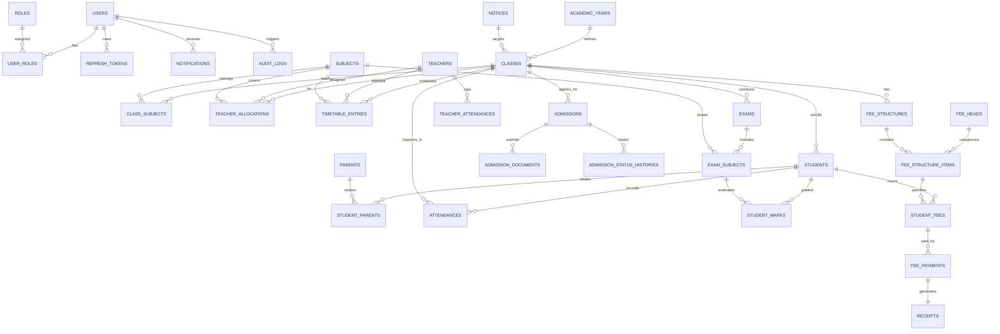

# Institutional ERP Database Schema & Architecture

This document specifies the relational database schema implemented in **PostgreSQL** via **Entity Framework Core 8** with snake_case naming conventions, soft delete query filters, and audit metadata.

## Key Entities & Constraints
1. **Users & Auth:**
   - Password hashing: `BCrypt.Net-Next` (WorkFactor 12).
   - Refresh Token rotation: Expired on usage, stores client IP and revoked status.
2. **Admissions:**
   - Automatic reference generation: `ADM-YYYY-####`.
   - On Approval: Instantly invokes transaction generating Student record, Student User (`student{N}@institution.edu`), Parent User (`parent{N}@family.com`), and links via `StudentParent`.
3. **Attendance:**
   - Unique constraint: `(StudentId, Date)` prevents duplicate daily records.
   - Triggers automated notifications to parents for any student marked `Absent`.
4. **Fees & Receipts:**
   - Payment modes: Cash, Card, Cheque, UPI, BankTransfer, OnlineGateway.
   - QuestPDF engine generates immutable, downloadable PDF receipts with receipt numbering `REC-YYYY-####`.
5. **Grading & Report Cards:**
   - Percentage calculation and letter grade resolution (A+, A, B+, B, C, D, F).
   - QuestPDF engine generates full institution-branded report cards.
